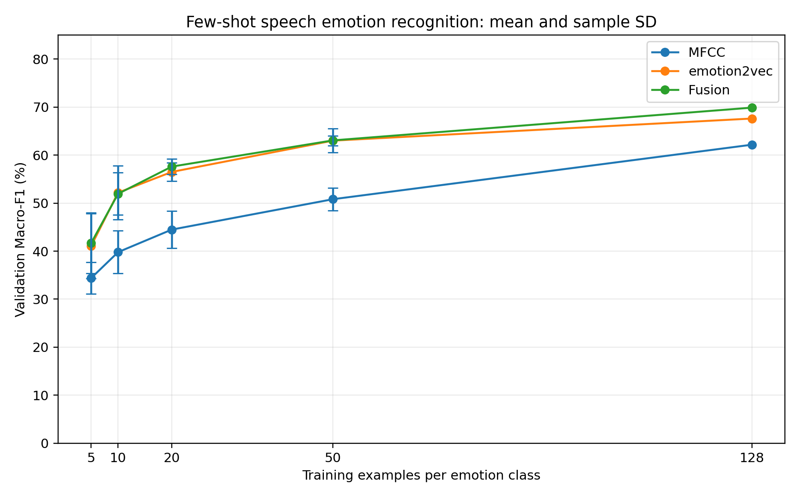
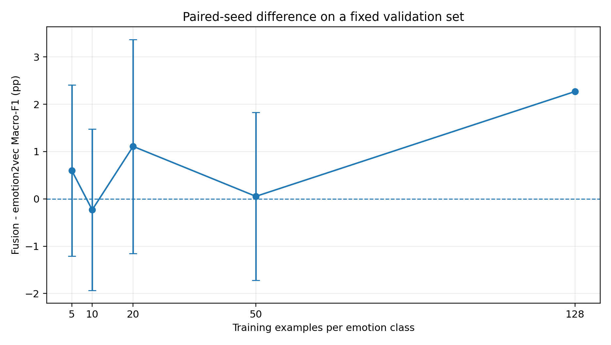
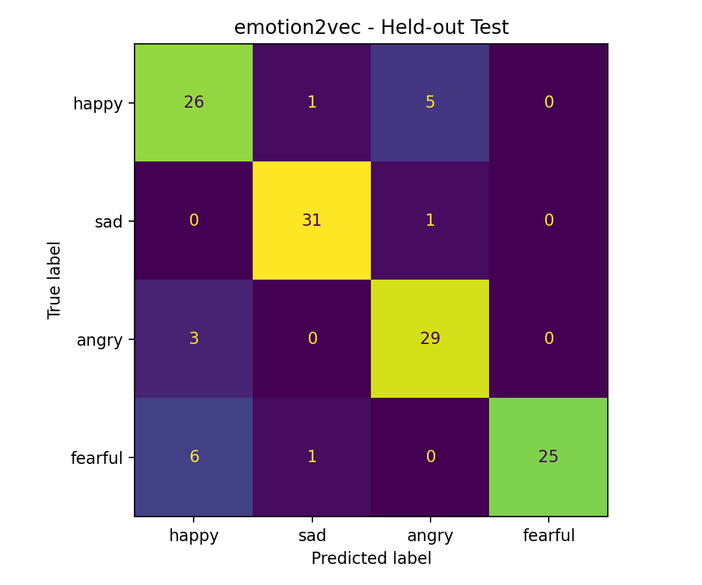

# 低資源語音情緒辨識：傳統聲學特徵與預訓練表徵融合之效能分析

*Few-shot Speech Emotion Recognition with Acoustic and Pre-trained Representation Fusion*

本研究探討在**標註語音資料有限**的情況下，不同特徵表示方式對語音情緒辨識（Speech Emotion Recognition, SER）的影響。以 RAVDESS 資料集為基礎，比較傳統 **MFCC**、預訓練 **emotion2vec** 表徵，以及兩者的 **Early Fusion**，並使用相同的 RBF Support Vector Machine（SVM）作為分類器。

研究著重於三個面向：少樣本資料量與辨識效能的關係、預訓練表徵的優勢，以及特徵融合在未見過的說話者上是否仍有幫助。

> **主要結果：** emotion2vec 在各項少樣本驗證設定中均優於 MFCC；Fusion 在完整訓練資料的驗證集取得最高 Macro-F1（69.89%），但在保留的獨立說話者測試集上，單獨使用 emotion2vec 的 Macro-F1 最高（86.82%）。這顯示特徵融合的效益並非在所有條件下都能保持一致。

## 研究問題

1. 當每類情緒的標註語音由 5 筆增加至 128 筆時，辨識效能如何變化？
2. 相較於傳統 MFCC，預訓練的 emotion2vec 表徵是否更適合少樣本情緒辨識？
3. 結合兩種特徵是否能穩定提升效能，並改善對未見過說話者的泛化能力？

## 資料集與切分方式

採用 [RAVDESS](https://zenodo.org/records/1188976) 的 **Audio-only Speech** 資料，選取四類情緒：Happy（開心）、Sad（悲傷）、Angry（憤怒）、Fearful（恐懼），共 **768 筆語音**，每類 192 筆。

依演員（Actor）切分資料，確保訓練集、驗證集與測試集之間**沒有重複說話者**：

| 資料切分 | Actor | 語音數量 | 每類數量 | 用途 |
| --- | --- | ---: | ---: | --- |
| Training | 01–16 | 512 | 128 | 訓練模型、擬合標準化器 |
| Validation | 17–20 | 128 | 32 | 超參數選擇、少樣本分析與錯誤分析 |
| Held-out Test | 21–24 | 128 | 32 | 鎖定模型後的最終獨立測試 |

資料集與模型權重均不隨本 Repository 重新散布。RAVDESS 的授權為 [CC BY-NC-SA 4.0](https://creativecommons.org/licenses/by-nc-sa/4.0/)；emotion2vec 權重的使用條件請見其 [Model Card](https://huggingface.co/emotion2vec/emotion2vec_base)。

## 研究方法

### 特徵擷取

| 方法 | 特徵表示 | 維度 |
| --- | --- | ---: |
| MFCC | 40 個 MFCC 係數，沿時間軸計算平均值與標準差 | 80 |
| emotion2vec | 凍結的 `emotion2vec_base` 預訓練模型，擷取 utterance-level embedding | 768 |
| Early Fusion | 分別標準化 MFCC 與 emotion2vec，再依序串接 | 848 |

語音在特徵擷取過程中轉為 16 kHz。Fusion 的兩個分支分別使用只在訓練資料上擬合的 StandardScaler，再將轉換後的特徵串接，避免使用 Validation 或 Test 估計標準化參數。

### 分類器與模型選擇

三種特徵皆使用 **RBF SVM**。超參數搜尋範圍：

- `C ∈ {0.1, 1, 10, 100}`
- `gamma ∈ {0.001, 0.01, 0.1}`

在固定 Validation 集上，依 Macro-F1、UAR、Accuracy 的順序選擇最佳組合；如分數相同，再偏好較小的 C 與 gamma。

| 模型 | C | gamma |
| --- | ---: | ---: |
| MFCC + SVM | 100 | 0.01 |
| emotion2vec + SVM | 10 | 0.001 |
| Early Fusion + SVM | 10 | 0.001 |

這些設定於最終測試前固定，沒有依 Test 成績重新調參或訓練。

## 實驗結果

### 1. 完整訓練資料：Validation

使用 512 筆訓練語音（每類 128 筆），在 128 筆 Validation 語音上評估：

| 模型 | Accuracy | Macro-F1 | UAR |
| --- | ---: | ---: | ---: |
| MFCC + SVM | 61.72% | 62.17% | 61.72% |
| emotion2vec + SVM | 67.97% | 67.62% | 67.97% |
| **Early Fusion + SVM** | **70.31%** | **69.89%** | **70.31%** |

原始結果：[三模型驗證比較](results/model_comparison_val.csv)。

### 2. 少樣本實驗：Validation

每種情緒分別抽取 5、10、20、50 與 128 筆訓練資料。5–50-shot 使用五組隨機種子（42、123、2026、3407、777），三個方法使用**相同的抽樣索引**進行配對比較。每次抽樣都重新以當次訓練資料擬合標準化器。

下表為 **Validation Macro-F1**；5–50-shot 顯示五次抽樣平均值，128-shot 因使用相同完整訓練資料，只有一次獨立訓練結果。

| 每類訓練數量 | MFCC | emotion2vec | Fusion |
| ---: | ---: | ---: | ---: |
| 5 | 34.41% | 41.11% | **41.71%** |
| 10 | 39.80% | **52.18%** | 51.95% |
| 20 | 44.49% | 56.50% | **57.61%** |
| 50 | 50.82% | 63.02% | **63.07%** |
| 128（完整訓練） | 62.17% | 67.62% | **69.89%** |

emotion2vec 在全部五種資料量下均優於 MFCC。Fusion 在部分設定下有小幅改善，但不穩定：例如 10-shot 時，emotion2vec 略優於 Fusion。

圖中的誤差棒反映**固定 Validation 說話者下，改變訓練樣本抽樣所造成的樣本標準差**，並非跨測試集的信賴區間；128-shot 只有一次獨立訓練，不繪製標準差。

原始紀錄與分析：

- [逐次少樣本實驗（75 筆紀錄）](results/fewshot_runs_val.csv)
- [各訓練資料量摘要（15 組）](results/fewshot_summary_val.csv)
- [統計分析](results/day9_summary_val.csv)
- [Fusion 相對 emotion2vec 的配對差異](results/day9_paired_fusion_vs_e2v_val.csv)

### 3. 保留測試集：Held-out Test

在模型與特徵檔案經 SHA-256 核對、參數固定後，以 **Actor 21–24 共 128 筆未參與模型選擇的語音**進行一次最終評估。使用已儲存的模型，不重新訓練或根據 Test 結果調參。

| 模型 | Test Accuracy | Test Macro-F1 | Test UAR |
| --- | ---: | ---: | ---: |
| MFCC + SVM | 49.22% | 49.78% | 49.22% |
| **emotion2vec + SVM** | **86.72%** | **86.82%** | **86.72%** |
| Early Fusion + SVM | 82.03% | 82.17% | 82.03% |

其餘測試集混淆矩陣：[MFCC](results/figures/test_confusion_mfcc.png) · [Fusion](results/figures/test_confusion_fusion.png)。

測試結果：[整體指標](results/heldout_metrics.csv) · [各情緒指標](results/heldout_per_class.csv) · [逐筆預測](results/heldout_predictions.csv)。

### 4. 錯誤分析

除了整體 Macro-F1，也在固定 Validation 集上觀察各情緒類別的 Precision、Recall、F1-score，以及 Fusion 相對 emotion2vec **修正了哪些錯誤、又新增了哪些錯誤**。

- [各情緒類別指標](results/day10_per_class_val.csv)
- [逐筆錯誤比較](results/day10_error_samples_val.csv)
- Validation 混淆矩陣：[MFCC](results/figures/confusion_mfcc_val.png) · [emotion2vec](results/figures/confusion_emotion2vec_val.png) · [Fusion](results/figures/confusion_fusion_val.png)

## 討論與研究限制

目前觀察到：

1. **預訓練表徵的優勢較明顯。** 在固定 Validation 的各種訓練資料量下，emotion2vec 均優於 MFCC。
2. **融合不一定提升泛化表現。** Fusion 雖在完整訓練的 Validation 取得最高分，但在保留 Test 集反而落後 emotion2vec。
3. **說話者組成可能影響測試結果。** Validation 與 Test 的表現差異較大，尤其 MFCC 在 Test 上下降，顯示特徵表示與資料切分值得進一步探討。

本研究的解讀範圍有以下限制：

- RAVDESS 為**英語表演式情緒語音**，不等同於真實生活或臨床情境的情緒狀態。
- 最終 Test 僅包含四位說話者，單次切分的結果不足以推論廣泛的跨語料泛化能力。
- 超參數選擇與少樣本分析使用同一組 Validation 說話者，可能產生選擇偏差。
- 五組 seed 衡量的是訓練樣本抽樣差異，不能視為五個獨立的測試集。
- Fusion 雖分別標準化各特徵維度，但兩個分支維度不同，可能影響 RBF 距離中的相對權重。
- 無法完全排除公開資料集與外部預訓練資料之間可能的重疊。

後續可研究特徵分支加權、不同說話者切分、跨資料集測試及噪音與異常輸入下的穩健性。

## 專案結構

~~~text
FewShot-SER-Feature-Fusion/
├── README.md
├── requirements-day1.txt
├── configs/
│   └── final_evaluation_protocol.json
├── data/
│   └── metadata.csv
├── scripts/
│   ├── prepare_dataset.py
│   ├── extract_mfcc.py
│   ├── check_mfcc.py
│   ├── extract_emotion2vec.py
│   ├── train_svm.py
│   ├── train_emotion2vec_svm.py
│   ├── train_fusion_svm.py
│   ├── run_fewshot.py
│   ├── analyze_fewshot.py
│   ├── analyze_errors.py
│   ├── pretest_audit.py
│   └── evaluate_heldout.py
└── results/
    ├── fewshot_runs_val.csv
    ├── fewshot_summary_val.csv
    ├── heldout_metrics.csv
    ├── heldout_per_class.csv
    ├── heldout_predictions.csv
    └── figures/
~~~

原始 WAV、特徵快取、模型檔及權重不放入版本控制；實際保存規則請見 [.gitignore](.gitignore)。

## 環境與實驗重現

下列指令以 **Windows PowerShell、Python 3.10、NVIDIA GPU** 為例。原實驗使用 PyTorch 2.6.0（CUDA 12.6）、FunASR、Librosa 與 Scikit-learn；套件版本紀錄於 [requirements-day1.txt](requirements-day1.txt)。

### 1. 建立環境

~~~powershell
py -3.10 -m venv .venv
$py = ".\.venv\Scripts\python.exe"
& $py -m pip install --extra-index-url https://download.pytorch.org/whl/cu126 -r requirements-day1.txt
& $py -c "import torch; print(torch.__version__, torch.version.cuda); print(torch.cuda.is_available())"
$env:HF_HUB_DISABLE_XET = "1"
~~~

`HF_HUB_DISABLE_XET` 是 Hugging Face 模型下載遇到 Xet 相容性問題時可使用的設定。

### 2. 準備資料與特徵

由 [RAVDESS 官方資料頁](https://zenodo.org/records/1188976) 下載 `Audio_Speech_Actors_01-24.zip`，將 `Actor_01` 至 `Actor_24` 資料夾放在 `data/raw/RAVDESS/` 底下。

~~~powershell
& $py scripts/prepare_dataset.py
& $py scripts/extract_mfcc.py
& $py scripts/check_mfcc.py
& $py scripts/extract_emotion2vec.py
& $py scripts/extract_emotion2vec.py --verify-only
~~~

emotion2vec 特徵擷取支援中斷後續跑，執行期間會定期建立本機 checkpoint。`--verify-only` 會檢查特徵形狀、有限數值與資料列對齊。

### 3. 模型訓練與驗證分析

~~~powershell
& $py scripts/train_svm.py
& $py scripts/train_emotion2vec_svm.py
& $py scripts/train_fusion_svm.py
& $py scripts/run_fewshot.py
& $py scripts/analyze_fewshot.py
& $py scripts/analyze_errors.py
~~~

上述流程產生驗證集模型比較、少樣本統計、混淆矩陣及逐筆錯誤分析。`joblib` 模型檔只應由可信來源載入。

### 4. 已鎖定模型的測試程序

~~~powershell
& $py scripts/pretest_audit.py
& $py scripts/evaluate_heldout.py
# 只有在預先鎖定的模型與雜湊檢查通過後，才執行正式測試
& $py scripts/evaluate_heldout.py --run
~~~

[final_evaluation_protocol.json](configs/final_evaluation_protocol.json) 記錄原實驗的模型設定與檔案 SHA-256。**上面的最終測試指令是原實驗的凍結評估流程說明，並非建議重複執行既有 Test。** 在新的環境重新訓練，模型與特徵檔雜湊可能不同，因此不能直接視為原本已鎖定的同一組模型；若已有 Test 結果，評估程式也會拒絕覆寫輸出。

## 參考資料

- Livingstone, S. R., & Russo, F. A. (2018). [The Ryerson Audio-Visual Database of Emotional Speech and Song (RAVDESS)](https://doi.org/10.1371/journal.pone.0196391). [資料下載頁](https://zenodo.org/records/1188976)。
- Ma et al. [emotion2vec: Self-Supervised Pre-Training for Speech Emotion Representation](https://arxiv.org/abs/2312.15185)。
- [emotion2vec_base — Hugging Face Model Card](https://huggingface.co/emotion2vec/emotion2vec_base)。
- [FunASR](https://github.com/modelscope/FunASR)。
